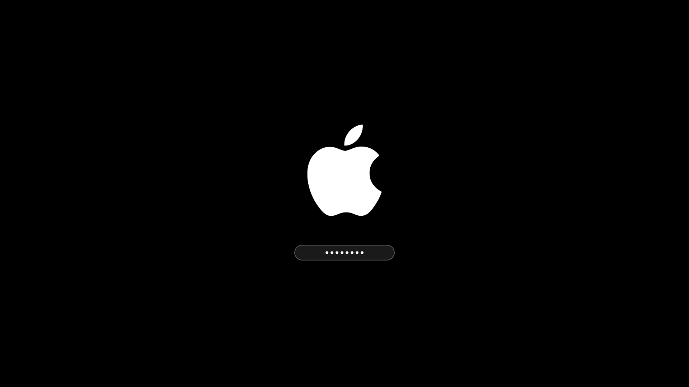
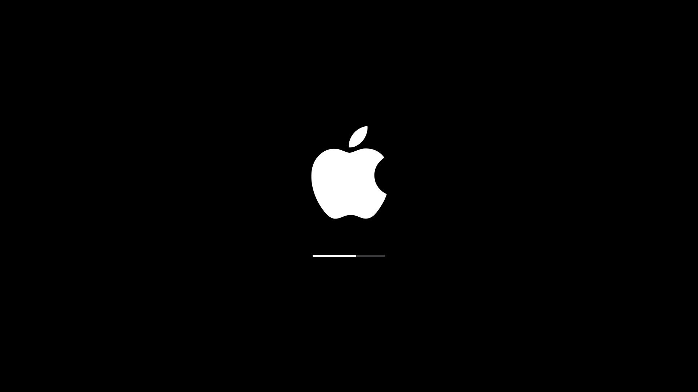

# Apple Boot

A Plymouth theme that turns a Linux boot into a Mac one: pure black, a white
logo, a slim pill progress bar, and a FileVault-style passphrase field for
encrypted disks.





<sub>Rendered from the theme's own assets at the exact geometry the script
computes for 1920×1080 — not photographs of a boot screen.</sub>

## Why this isn't just a logo swap

Dropping an Apple logo into an existing theme gets you an Apple logo on someone
else's boot screen. The parts that actually read as "Mac" are everything around
it, so all of it was rebuilt:

| | Typical dark theme | Here |
|---|---|---|
| Background | near-black with a hue (`#1a1b26`, `#282a36`…) | pure black, console log included |
| Logo | wide wordmark | 256px mark, centred at 44% height |
| Progress bar | flat rectangle, accent-coloured | 200×6 white pill on a `#3a3a3c` track |
| Passphrase field | opaque box | 280×44 translucent pill with a hairline border |
| Padlock icon | shown beside the field | none — FileVault doesn't show one |
| Password dots | left-aligned, accent-coloured | 8px white, centred in the field |
| Error text | top-left corner | centred under the field |

The logo sits slightly above true centre so the logo-plus-control group reads as
optically centred, which is what macOS does.

## Install

```bash
git clone https://github.com/skylightlim/apple-boot.git
cd apple-boot
sudo ./scripts/install.sh
```

Then reboot.

The theme installs to `/usr/share/plymouth/themes/apple/` as its own directory.
It never overwrites a theme your distro ships, so a package upgrade can't clobber
it — on Omarchy, `/usr/share/plymouth/themes/omarchy/` belongs to the
`omarchy-settings` package and is replaced on every update.

### Use your own logo

Any PNG with transparency. It's converted to real RGBA and shrunk to fit:

```bash
sudo ./scripts/install.sh --logo ~/Downloads/my-logo.png
sudo ./scripts/install.sh --logo ~/Downloads/my-logo.png --logo-size 192
```

Plymouth draws the logo at its **native pixel size** — there is no scaling at
boot, so `--logo-size` *is* its on-screen size. 256 suits a 1080p panel; drop to
128 for something closer to a real Mac. The flag only ever shrinks, so a small
source image is never upscaled into a blur.

A white-on-transparent mark is what you want. On pure black, anything else
needs its own contrast check.

### Uninstall

```bash
sudo ./scripts/uninstall.sh
```

Switches back to the first of `omarchy`, `bgrt`, `spinner`, `text` that's
installed, deletes the theme directory, and rebuilds. Pass `--theme NAME` to
pick a different one.

## Encrypted disks

Boot progress reports freeze while a LUKS volume decrypts, so a bar driven
purely by real progress sits still through the longest part of the boot. The
fake-progress easing that covers this is inherited from the Omarchy theme and
left intact: the bar eases to 70% over 15 seconds, then hands over to real
progress once that overtakes it.

The order on an encrypted system is logo → passphrase field → logo with progress
bar. The bar deliberately doesn't appear before the passphrase.

**If the splash ever misbehaves, press Esc at the prompt.** That drops Plymouth
to the plain text console, where you can still type your passphrase and boot.
Worth knowing before you reboot into a theme for the first time.

## Rebuilding the boot image

`install.sh` picks the right tool:

| Detected | Runs |
|---|---|
| `limine-mkinitcpio` | `limine-mkinitcpio` |
| `mkinitcpio` | `mkinitcpio -P` |
| `dracut` | `dracut --force --regenerate-all` |

The Limine check comes first on purpose. Omarchy and other Limine setups boot a
**UKI**, and `mkinitcpio -P` rebuilds the initramfs while leaving the UKI that
actually boots untouched — the theme change then silently does nothing. If you
change the theme by hand later, remember to use `limine-mkinitcpio`.

## Tuning it

Layout lives in two constants at the top of `theme/apple.script`:

```
global.logo_center_ratio = 0.44;   # logo centre, as a fraction of screen height
global.control_gap = 80;           # px between logo bottom and the field/bar
```

Edit, re-run `install.sh`, reboot. The bar and the passphrase field share a band,
so the bar appears exactly where the field was once the volume unlocks — move one
and the other follows.

## Credits

`theme/apple.script` is derived from the Plymouth theme in
[Omarchy](https://github.com/basecamp/omarchy) by
[@dhh](https://github.com/dhh), MIT licensed. The progress-callback structure
and the fake-progress easing are theirs; the layout, assets and styling are not.

## Trademark

The Apple logo is a trademark of Apple Inc. This project is not affiliated with,
endorsed by, or sponsored by Apple Inc. The bundled mark is here so the theme
works out of the box for personal use — if that's a problem for yours, install
with `--logo` and supply your own.

## License

MIT — see [LICENSE](LICENSE).
